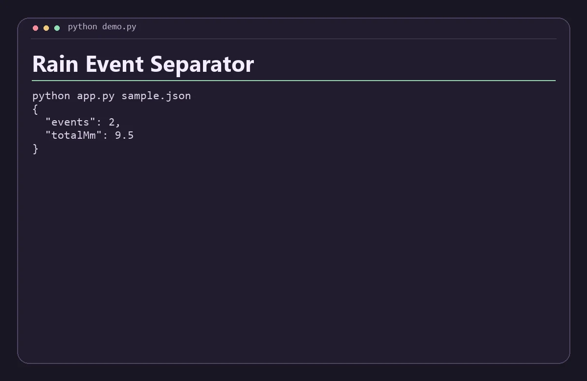

# Rain Event Separator

Group timestamped rainfall readings into storms using a configurable dry gap.



## Run

Install Python 3.11 or newer. Run these commands from the repository root.

```sh
python app.py sample.json
```

Replace `sample.json` with a JSON file following the same structure. The app prints a JSON report to standard output.

Each reading is an ISO timestamp with an explicit offset and a nonnegative millimeter amount. A gap of at least the requested hours between positive readings starts a new event.

## Verify

Run `python check.py` with Python 3.11 or newer after the build step when applicable. The check verifies the bundled scenario and confirms that an invalid input returns an error.
